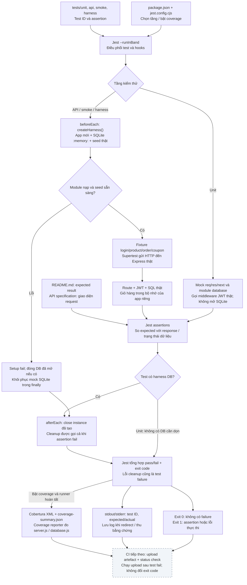

# Kiến trúc test harness EShop — B-05

Sơ đồ mô tả harness backend đã triển khai trong B-02–B-04: nguồn test, fixture, runner, artefact, log và quality gate. GitHub Actions/Jenkins, upload artefact và branch protection thuộc phần CI tiếp theo, chưa được cấu hình trong repo tại thời điểm lập sơ đồ.

## 1. Sơ đồ tổng quan dùng cho guide và slide

[SVG để chỉnh sửa hoặc chèn vào slide](assets/test-harness-overview.svg) · [PNG 1920 × 1080](assets/test-harness-overview.png).

Các mũi tên thể hiện luồng điều khiển/dữ liệu giữa thành phần. Không có script tổng tự nối `npm ci`, lint, build và test; hiện nhóm chạy các lệnh riêng. Box quality gate mô tả cách đọc exit code tại local và hợp đồng cần giữ khi tích hợp CI.

## 2. Luồng chi tiết và vòng đời mỗi test

Unit test dùng stub database, không chạy SQL seed. API/smoke/harness test dùng SQLite thật với constructor được chuyển sang `:memory:`. `database.js` vẫn chạy SQL tạo bảng và seed thật; `jest.isolateModules` tạo scope module mới, nên `userCarts` cũng mới. Mock constructor được khôi phục ngay sau bước nạp module, không đợi đến teardown. Khi seed sẵn sàng, helper kiểm tra số lượng sáu bảng trước khi trả app cho test.

`close()` dùng cùng Promise cho các lần gọi, giúp teardown lặp lại an toàn. Nếu setup thất bại trước khi trả harness, helper tự dọn kết nối đã mở; `afterEach` chỉ dọn instance đã có. Cleanup là thao tác thực tế: nếu đóng kết nối lỗi, lần chạy phải báo lỗi, không coi đó là bug nghiệp vụ đã được xác nhận. Hết process thì app và giỏ hàng trong bộ nhớ không được dùng lại.

## 3. Thành phần và vị trí trong repo

| Thành phần | Vị trí / lệnh | Trách nhiệm và giới hạn |
| --- | --- | --- |
| Đặc tả | [README.md](../../README.md), [API specification](../../api_specification.md) | Đặc tả quyết định expected; API document hướng dẫn request |
| Nguồn test | [tests](../../backend/tests/README.md): `unit/`, `api/`, `smoke/`, `harness/` | 5 unit, 30 API, 1 smoke API, 3 kiểm tra harness; không phải GUI/mobile E2E |
| Fixture / seed / mock | [harness.js](../../backend/tests/helpers/harness.js), [database.js](../../backend/database.js) | Dữ liệu đầu vào và DB riêng mỗi test; không mock response/công thức nghiệp vụ |
| Runner | [Jest config](../../backend/jest.config.cjs), [npm scripts](../../backend/package.json) | `test`, các lệnh theo tầng, `test:coverage`, `test:ci`; timeout mỗi test 10 giây |
| SUT | [server.js](../../backend/server.js) | Import app không mở port 3000; Supertest quản lý HTTP server tạm cho request |
| Lint / build | [ESLint config](../../backend/eslint.config.cjs), [check-syntax.cjs](../../backend/scripts/check-syntax.cjs) | Lint code; build kiểm tra cú pháp thật, không tạo bundle |
| Artefact | `backend/coverage/cobertura-coverage.xml`, `coverage-summary.json` | Chỉ sinh khi bật coverage; thư mục coverage được Git ignore |
| Log | stdout/stderr và [bằng chứng B-04](../evidence/B-04/clean-clone.log) | Log không tự lưu ra file nếu chưa redirect; file bằng chứng là snapshot lần chạy đã thu |
| Diagnostic | [verify-isolation.cjs](../../backend/scripts/verify-isolation.cjs) | Ba child Jest process; so từng tên test, danh sách fail, open handles và hash DB |
| Quality gate | Exit code của từng lệnh; CI status check là phần tiếp theo | Không có gate CI/branch protection đang hoạt động chỉ vì đã có `test:ci` |

`test:isolation` dùng report JSON trong thư mục tạm riêng rồi xóa chúng. Nó không xuất coverage mặc định. Muốn giữ full test JSON cho một run khác, chỉ định `--json --outputFile=...`; đây là tùy chọn, không phải output mặc định của `test:ci`.

## 4. Đọc quality gate và bằng chứng

| Tình huống | Trạng thái cần giữ | Cách đọc |
| --- | --- | --- |
| Cài đặt, lint hoặc build lỗi | Nonzero exit của lệnh tương ứng | Chưa có bằng chứng các bước sau đã chạy; CI nên thể hiện đúng bước lỗi |
| Test thực thi, assertion đạt hết | Jest exit 0 | Chỉ xác nhận tập assertion đã chạy, không chứng minh toàn bộ EShop đúng |
| Assertion không đạt | Jest exit 1; giữ test ID và expected/actual | Phân tích để phân biệt bug SUT, fixture sai và vấn đề môi trường |
| Setup, import, timeout hoặc cleanup lỗi | Jest fail/nonzero, không tự chuyển thành pass | Có thể chưa thực hiện được assertion nghiệp vụ; cần đọc lỗi gốc |
| Test fail nhưng coverage sinh được | Test vẫn đỏ; report được lưu riêng | Coverage cho biết code đã thực thi, không làm thay đổi verdict của test |
| `test:isolation` exit 0 | Diagnostic ổn định | Không thay thế verdict của `test`/`test:ci` |
| Upload report thất bại | Lỗi thu artefact riêng với verdict test | Không sửa kết quả test; CI cần hiển thị việc thiếu bằng chứng |

Trong CI tiếp theo, status check phải dựa vào các bước kiểm tra đã cấu hình, không chỉ việc có file report. Bước upload cần chạy sau test fail khi runner còn hoạt động, nhưng upload thành công không đổi test đỏ thành xanh. Cấu hình này thuộc C-01/C-04/C-05 và D-02/D-03, chưa được thực hiện bởi B-05. Đề hiện tại không quy định coverage threshold; không thêm một ngưỡng giả định vào sơ đồ.

Snapshot local B-04: lint/build pass; 39 test gồm 29 pass và 10 fail đã đối chiếu đặc tả; line coverage 61,48%. B-03 đã ghi ba seed cho cùng trạng thái từng test, không có open handles và database gốc không đổi. Các con số là kết quả lần kiểm chứng đã ghi, không phải hằng số của kiến trúc hoặc coverage badge tự cập nhật.

## 5. Trường hợp biên và cách tránh đọc sai sơ đồ

| Trường hợp biên | Hành vi / điều cần kiểm tra |
| --- | --- |
| Lockfile/dependency/native SQLite không cài được | Runner chưa thể khởi động; giữ log cài đặt, không dùng report cũ để thay kết quả |
| Sai seed hoặc setup lỗi | Helper không trả harness hợp lệ; test phải fail. Không kết luận route sai khi chưa gọi route được |
| Assertion fail nhưng teardown tiếp tục | `afterEach` vẫn được Jest gọi; `close()` idempotent. Lỗi teardown có thể thêm hoặc che lỗi trước, phải đọc toàn bộ log |
| Timeout 10 giây, crash hoặc hủy job | Cleanup/report không được bảo đảm khi process bị kết thúc. Không giả định luôn có coverage XML; `--detectOpenHandles` chỉ giúp chẩn đoán, không tự đóng tài nguyên |
| Không tìm thấy test / test skip | Không coi là bộ test đã được thực hiện đầy đủ. Cấu hình không dùng `--passWithNoTests`; diagnostic yêu cầu đúng số test và không có pending test |
| Chạy cùng lúc các instance / test | Mỗi app/DB riêng; có test xác nhận instance mới không reset instance cũ. Không dùng `test.concurrent` với helper module isolation hiện tại |
| Chỉ chạy unit hoặc smoke | Không suy ra API test đã chạy. Chạy subset với coverage không có cùng độ phủ như full suite |
| Coverage file còn từ run trước | Dùng workspace/report directory sạch, hoặc xác minh file thuộc run/commit hiện tại trước khi upload. Đây là trách nhiệm runner CI tiếp theo, không phải cơ chế tự có của npm scripts |
| Report thiếu, rỗng, XML sai hoặc counters không phù hợp | Đánh dấu bằng chứng không hợp lệ; việc tồn tại file không chứng minh report đúng. Snapshot B-04 đã được parse và kiểm tra hai file nguồn |
| Thêm test hoặc sửa bug | Cập nhật baseline 39 test/mười ID lỗi của diagnostic sau khi xác minh, không sửa assertion chỉ để giữ baseline |
| Thứ tự hoặc flake | Ba seed chỉ kiểm tra các thứ tự đã chạy, không chứng minh mọi thứ tự. Thí nghiệm flaky 10 lần thuộc E-01–E-09, tách khỏi pipeline chính |
| Giỏ hàng / dữ liệu giữa test | Không dùng database gốc và không khởi động `node server.js` riêng để phục vụ bộ test. Mỗi test tự tạo trạng thái cần thiết |
| Token/mật khẩu trong log | Review và loại dữ liệu nhạy cảm trước khi chia sẻ. Không đưa output `test_profile.js` vào artefact công khai vì script này in JWT |

## 6. Sử dụng lại

Guide có thể dẫn trực tiếp tới tài liệu này hoặc nhúng hình PNG; slide có thể dùng SVG để giữ chữ/đường nét rõ hoặc PNG 1920 × 1080. Giữ phần ghi chú “CI tiếp theo” khi trình bày để tránh hiểu nhầm upload/status check đã triển khai. Mermaid phía trên là nguồn chỉnh sửa của luồng chi tiết; SVG/PNG là bản tổng quan để trình chiếu, không cố nhồi mọi nhánh lỗi vào một slide.

Reviewer thực tế theo yêu cầu hiện tại: Dương. Dòng phân công trong checklist được giữ nguyên. AI hỗ trợ đối chiếu mã nguồn, biên soạn và vẽ sơ đồ; tài liệu không ghi nhận một lần peer review chưa diễn ra.
