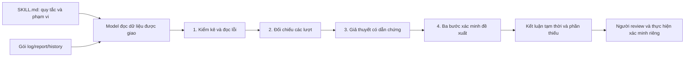

# Demo ci-log-triage — Từ log đến giả thuyết và bước kiểm tra

> Các ví dụ và walkthrough trong bộ demo này dùng **dữ liệu v1 — cart** và output Sol v1. Phương pháp có thể dùng lại; quy trình chạy, định dạng log và gói dữ liệu v2 xem protocol hiện hành. Không dùng lời giải/demo v1 để dựng kết quả phân tích v2. [Protocol v2 hiện hành](../../../experiments/order-history-protocol.md).

Biên soạn ngày 23/10/2026. Bộ tài liệu giải thích [skill đã chọn ở E-06](../ci-log-triage/SKILL.md) và đối chiếu với [output GPT-6.1 Sol đã bàn giao](../../E-08/ai-sol/response.md). Dùng cho báo cáo, User Guide hoặc người thuyết minh demo.

| Đọc theo thứ tự | Nội dung |
| --- | --- |
| [01 — Thành phần](01-thanh-phan.md) | Skill là gì, từng file và từng khối hướng dẫn làm gì; vai trò model, dữ liệu và công cụ |
| [02 — Walkthrough](02-walkthrough.md) | Bốn bước xử lý, dữ liệu vào/ra, bằng chứng cụ thể và cách hình thành kết luận/next-checks |
| [03 — Kịch bản demo](03-kich-ban-demo.md) | Chuẩn bị, thao tác trình bày, câu hỏi tương tác và cách áp dụng cho log khác |

## Sơ đồ tổng quan

Skill hướng dẫn cách làm; model thực hiện đọc và lập câu trả lời. Skill không phải parser Python, không tự thu CI, không có database lịch sử hoặc công thức dự đoán cố định. Những gì được cấp làm đầu vào quyết định phạm vi bằng chứng có thể sử dụng.

## Phạm vi của bản demo

- **Đã có:** nội dung skill, gói E-05 và output Sol được người dùng cung cấp; có thể đối chiếu các số liệu và cách output đáp ứng từng yêu cầu.
- **Không có:** bản ghi đầy đủ mọi tool call và mốc bắt đầu/kết thúc của phiên Sol gốc. Thời lượng phân tích đã ghi nhận là 1 phút 30 giây. Không khẳng định thứ tự mở từng file, mọi thao tác thực tế hay suy nghĩ nội bộ.
- Walkthrough là giải thích sau khi có kết quả, không phải bản ghi nguyên văn quá trình model suy luận. Một yêu cầu trong skill không tự chứng minh model đã tuân thủ hoàn toàn; phải kiểm tra output và, nếu có, tool log.
- Tài liệu có lời giải của ca EShop. Chỉ dùng cho người trình bày hoặc công bố sau khi người tham gia nộp phân tích; không gửi cùng ZIP để đánh giá độc lập.
- Không sửa skill, dữ liệu E-05, output gốc hoặc test khi tạo bộ demo này. Đây không phải một lượt AI triage mới.

Nguồn bổ sung: [hồ sơ điều chỉnh skill](../ci-log-triage/SOURCES.md), [so sánh E-08](../../E-08/AI_vs_Human_Triage.md), [kiểm chứng bản sửa E-09](../../E-09/README.md).
