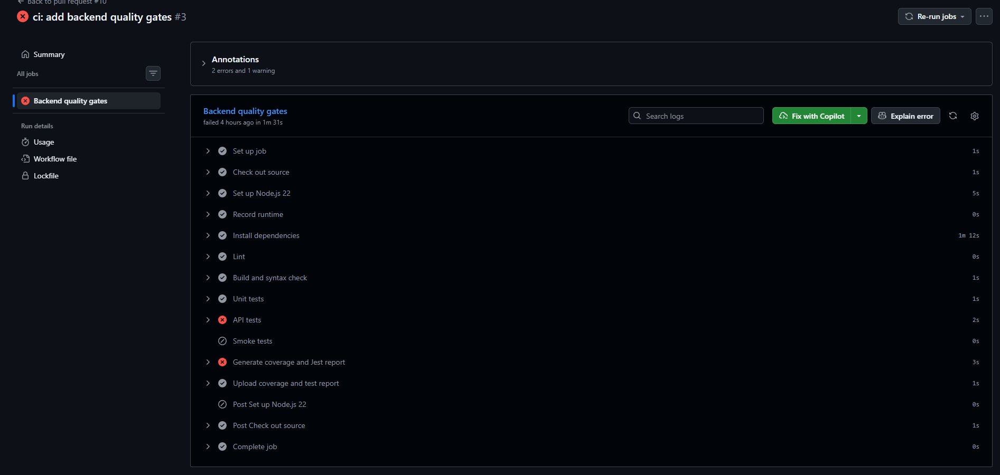

# Task C Evidence — GitHub Actions (C-01 to C-07)

## 1. Phạm vi báo cáo

Báo cáo này ghi nhận bằng chứng cho toàn bộ Task C-01 đến C-07 của hệ thống GitHub Actions cho backend EShop.

Phạm vi thực hiện:

- Chạy workflow trên Pull Request vào `main` và push vào `main`.
- Cố định runner `ubuntu-22.04` và Node.js `22.14.0`.
- Cài dependency bằng `npm ci`.
- Chạy quality gate theo thứ tự `lint -> build -> unit -> API -> smoke`.
- Giữ nguyên exit code thật của test; không skip, sửa expected hoặc dùng `continue-on-error` để che lỗi.
- Đo npm cache miss/hit và thời lượng tương ứng.
- Sinh, kiểm tra và upload coverage/test report khi runner chưa bị cancel.
- Cấu hình branch protection và kiểm tra PR pass/fail.
- Kiểm tra khả năng tái lập từ clone sạch.

Repository: EShop SUT Group 10  
Workflow: `Backend CI`  
Job: `Backend quality gates`  
Workflow source: [`.github/workflows/ci.yml`](../../.github/workflows/ci.yml)

> **Lưu ý về trạng thái baseline:** Ứng dụng EShop được thiết kế có chủ đích với một số lỗi nghiệp vụ. Nhóm đóng vai tester và test harness engineer, không tự ý sửa SUT hoặc sửa assertion chỉ để tạo run xanh. Các lỗi API được ghi nhận là kết quả kiểm thử của SUT.

---

## 2. C-01 — Workflow cơ bản

### 2.1. Tiêu chí

C-01 yêu cầu workflow:

- chạy khi có Pull Request vào `main`;
- chạy khi có push vào `main`;
- cố định phiên bản Node.js;
- cài dependency bằng `npm ci`;
- có URL run để truy xuất lại bằng chứng.

### 2.2. Implementation

Workflow hiện tại khai báo:

```yaml
on:
  pull_request:
    branches:
      - main
  push:
    branches:
      - main
```

Môi trường CI:

```yaml
runs-on: ubuntu-22.04
node-version: 22.14.0
```

Cài dependency:

```yaml
run: npm ci
```

Do dependency `sqlite3` có native binding, bước cài đặt bổ sung:

```yaml
env:
  npm_config_build_from_source: "true"
```

Việc này giúp native module được build trên chính runner `ubuntu-22.04`, tránh sử dụng binary không tương thích với phiên bản GLIBC của runner.

### 2.3. Evidence run

| Trường | Giá trị |
|---|---|
| Workflow run URL | `https://github.com/SUT-group10/eshop-sut-group10/pull/10` |
| Event | Pull Request vào `main` |
| Branch | `github-ci` |
| Commit SHA | `cf00005` |
| Runner OS | `ubuntu-22.04` |
| Node.js | `22.14.0` |
| npm | `10.9.2` |
| Kết quả tổng thể | Run được kích hoạt; quality gate phản ánh lỗi thật của pipeline |

### 2.4. Hình minh chứng

> ****  
> Ảnh GitHub Actions hiển thị workflow `Backend CI`, event Pull Request, branch `github-ci`, commit SHA.

### 2.5. Kết luận C-01

Workflow đã được GitHub nhận diện và chạy trên Pull Request. Trigger, runner, Node.js version và lệnh `npm ci` được cấu hình trong source. URL run và ảnh chụp cần được bổ sung vào bảng evidence trước khi nộp báo cáo.

---

## 3. C-02 — Quality gates theo thứ tự

### 3.1. Tiêu chí

C-02 yêu cầu thêm và thể hiện rõ chuỗi:

```text
lint -> build -> unit/API/smoke
```

Mỗi bước phải giữ exit code thật để khi một bước thất bại, các bước sau phản ánh đúng trạng thái bị dừng hoặc bỏ qua.

### 3.2. Các script được sử dụng

Các script nằm trong `backend/package.json`:

| Step CI | Script |
|---|---|
| Lint | `npm run lint` |
| Build và syntax check | `npm run build` |
| Unit tests | `npm run test:unit` |
| API tests | `npm run test:api` |
| Smoke tests | `npm run test:smoke` |
| Coverage và Jest report | `npm run test:ci` |

Workflow không dùng lệnh giả để làm pipeline xanh.

### 3.3. Kết quả run đầu tiên

Kết quả quan sát được sau khi đồng bộ test harness và script từ nhánh `develop`:

| Step | Kết quả | Nhận xét |
|---|---|---|
| Install | Pass | `npm ci` hoàn tất |
| Lint | Pass | ESLint hoàn tất |
| Build and syntax check | Pass | Syntax check hoàn tất |
| Unit tests | Pass | Unit test hoàn tất |
| API tests | Fail | Ban đầu gặp lỗi native `sqlite3`/GLIBC; sau khi build từ source, test chạy và phát hiện lỗi nghiệp vụ của SUT |
| Smoke tests | Skipped | Bị dừng sau khi API test fail |
| Generate coverage and Jest report | Failed/đỏ | `test:ci` chạy lại suite và giữ exit code fail khi assertion API không đạt |
| Upload report | `[BỔ SUNG KẾT QUẢ RUN]` | Kiểm tra artifact thực tế trên GitHub |

### 3.4. Phân biệt lỗi hạ tầng và lỗi SUT

Lỗi ban đầu:

```text
/lib/x86_64-linux-gnu/libm.so.6: version `GLIBC_2.38' not found
```

Đây là lỗi tương thích native binary của `sqlite3`, không phải lỗi assertion. Workflow đã được cập nhật để build native module từ source trên runner.

Sau khi xử lý lỗi này, API tests chạy được và tiếp tục phát hiện các lỗi nghiệp vụ đã ghi nhận trong test harness, ví dụ:

- sản phẩm trùng không được gộp trong giỏ hàng;
- checkout tin tổng tiền do client gửi;
- giỏ hàng không bị xóa sau checkout;
- user thường truy cập được admin API;
- coupon có lỗi ở điều kiện biên và công thức;
- trạng thái đơn hàng có thể bị chuyển trái với đặc tả.

Các test assertion và expected result không được sửa chỉ để làm pipeline xanh.

### 3.5. Hình minh chứng

> ****  
> Ảnh GitHub Actions hiển thị thứ tự step: Lint pass, Build pass, Unit pass, API fail, Smoke skipped và Coverage/report fail hoặc được tạo với trạng thái test fail.

### 3.6. Trạng thái hoàn thành C-02

**Implementation:** Đã triển khai chuỗi quality gate trong workflow.  
**Evidence hiện có:** Có run thể hiện step fail và nguyên nhân được chẩn đoán.  
**Run xanh:** Chưa có do baseline SUT có lỗi nghiệp vụ đã biết.  
**Run đỏ có chủ đích:** Chưa tạo từ một commit xanh.

---
